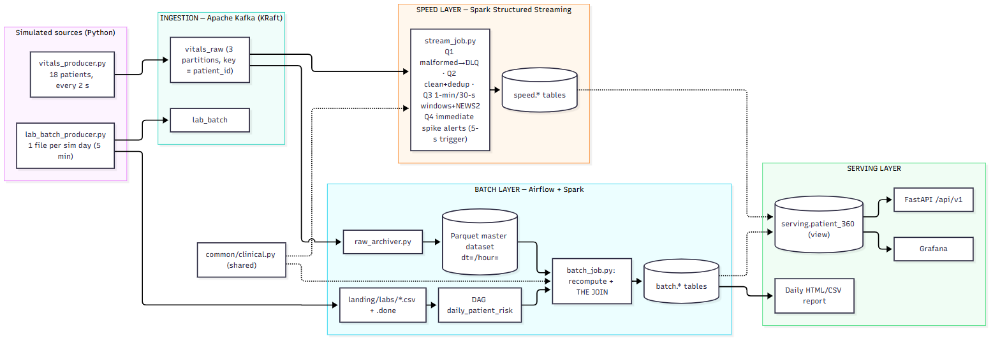
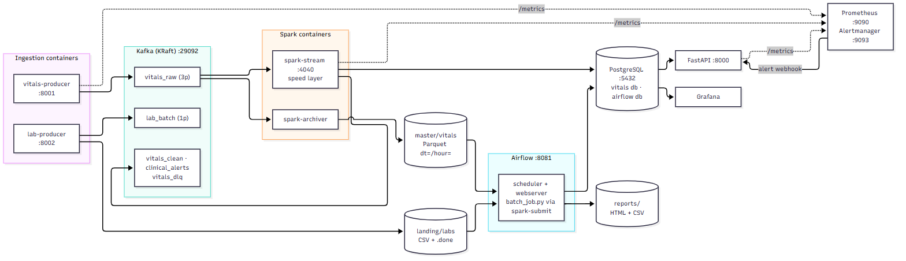
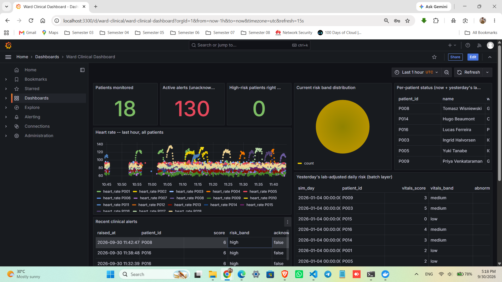
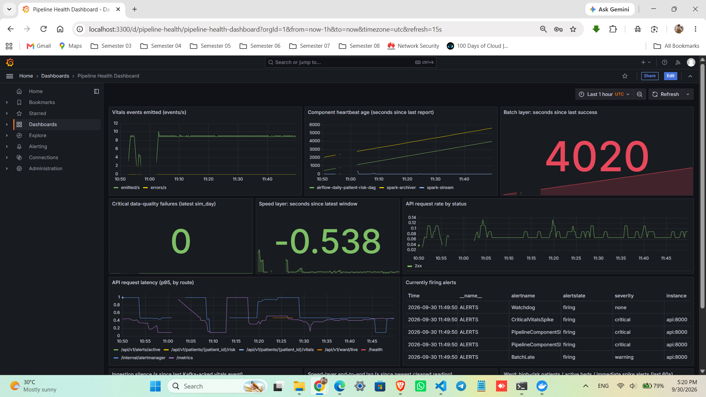
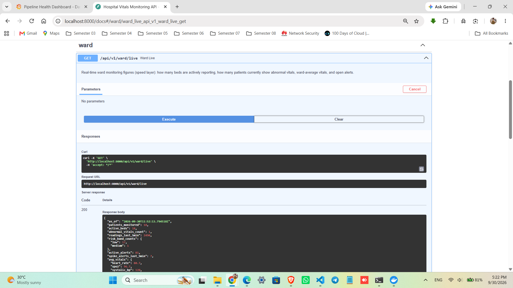
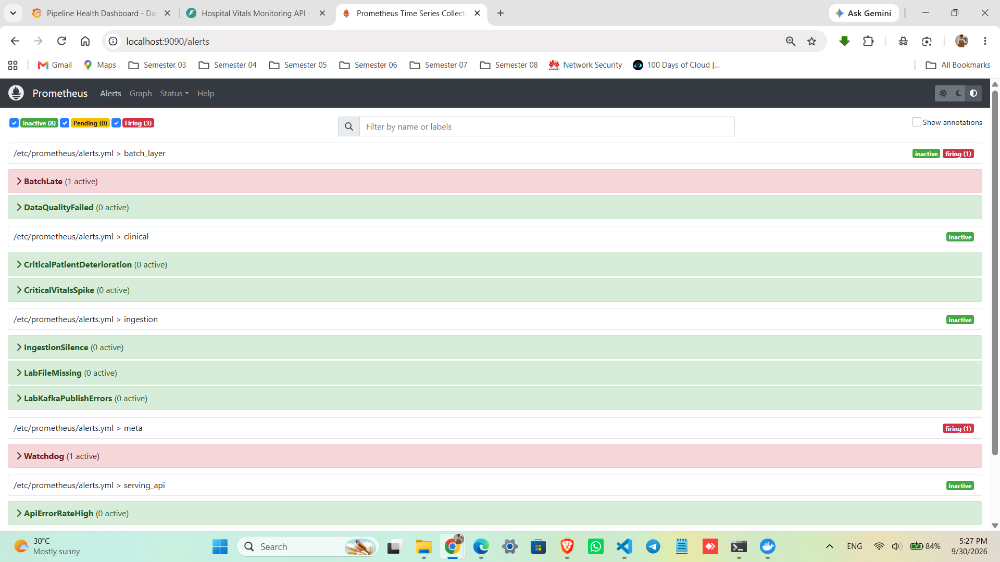

# Real-Time Patient Vital Signs Monitoring with a Lambda Architecture

**Module:** EC8203 Applied Big Data Engineering (Mini Project Assessment 2026)\
**Use case:** Use Case 2 — Hospital Patient Vital Signs Monitoring

**Group members**

| Registration No. | Name |
|---|---|
| EG/2020/3979 | Jayalath K.M.S.M. |
| EG/2020/3989 | Jayasinghe U.R. |
| EG/2020/4064 | Malinda H.W.J. |

*Stack: Apache Kafka · Spark Structured Streaming · Apache Airflow · PostgreSQL + Parquet · FastAPI · Prometheus / Grafana / Alertmanager*

---

## 1. Business Context and Clinical Problem Statement

### 1.1 The scenario

A hospital ward monitors patients through bedside sensors that report heart rate, oxygen
saturation (SpO₂), systolic and diastolic blood pressure and temperature every few seconds.
Once a day the pathology laboratory uploads a file of test results (troponin, creatinine,
white-cell count, CRP, lactate, electrolytes and others) for the same patients. The two data
sources differ in almost every respect:

| Property | Bedside vitals | Pathology lab results |
|---|---|---|
| Arrival pattern | Continuous, ~0.5 events/s per patient | One bulk file per day |
| Volume in this project | 18 patients × 1 event / 2 s ≈ 9 events/s ≈ 780 k events/day | ≈ 100 rows/day |
| Freshness needed | Seconds — a desaturating patient cannot wait for tomorrow | Daily — results are only produced daily |
| Data quality | Sensor faults, duplicates, late and malformed messages | Missing patients, duplicate rows, non-numeric values |
| Can be amended later? | No (a reading is a fact) | **Yes** — labs are re-issued and corrected |

### 1.2 The business question

> *Which patients show concerning vital-sign trends **right now**, and how do **yesterday's
> lab results** change the risk picture for those patients going forward?*

The question has two halves with different service-level expectations, and that structure
drives the whole design:

1. **"Right now"** — a near-real-time answer, measured in seconds, that may be
   approximate (a partial window of data is still useful to a nurse).
2. **"How do yesterday's labs change the picture"** — a once-a-day answer that must be
   *correct and reproducible*, because it combines a full day of vitals with the
   laboratory's authoritative values and is what a clinician would read in the morning
   handover.

### 1.3 Requirements interpreted from the brief

| # | Requirement (from the assessment brief) | How this project interprets it |
|---|---|---|
| R1 | Streaming source emitting every few seconds, occasional abnormal spikes | `vitals_producer.py`: 18 patients, mean-reverting random walk around per-patient baselines, injected sustained anomaly episodes (tachycardia, desaturation, hypotension, fever, sepsis pattern), ground truth logged |
| R2 | Daily batch source (file or API) | `lab_batch_producer.py`: atomic CSV drop per simulated day (+ `.done` marker, manifest with checksum) and the same rows published to Kafka topic `lab_batch` |
| R3 | Simulated clock stated clearly | **1 simulated day = 5 real minutes** (§ Appendix A) |
| R4 | Processing consistent with the chosen architecture; meaningful transformations | Cleaning, deduplication, event-time windowing with watermark, NEWS2-style scoring, stream–static enrichment, and the vitals × labs join (§3, §4) |
| R5 | Queryable store + consolidated report | PostgreSQL warehouse (`speed`, `batch`, `serving`, `ops` schemas), Parquet master dataset, FastAPI, Grafana, daily HTML/CSV report |
| R6 | Observability: structured logs + ≥ 1 alert/health rule | JSON logs with `trace_id` on every stage; 10 Prometheus alert rules (plus an always-firing watchdog) including a 30-second ingestion-silence check and two clinical-urgency alerts (§5) |
| R7 | Suggested outputs: real-time ward API, per-patient threshold alerts, daily consolidated risk report | `GET /api/v1/ward/live`, immediate + sustained alerts per patient, `daily_risk_report_<day>.html/.csv` |

---

## 2. Architecture Decision: Lambda versus Kappa

### 2.1 Decision

**Lambda architecture**: an immutable master dataset, a **batch layer** that recomputes
authoritative daily views from it, a **speed layer** that computes approximate real-time
views from the live stream, and a **serving layer** that merges the two at query time.
**Rejected alternative: Kappa** (one streaming code path over a replayable log).

The decision is not "Lambda is more powerful". It is that *this* problem has four
properties that fit Lambda's structure and strain Kappa's. Each is argued below, including
where Kappa would actually be competitive.

### 2.2 Latency

Kappa can deliver seconds-level results — Structured Streaming and Flink both do — so
latency alone does **not** decide between the architectures, and this report does not claim
it does. What latency contributes is a requirement for *two different latency classes over
two different sources*:

- Vital-sign alerts must reach a clinician within seconds. The speed layer has a dedicated
  fast path (`stream_job.py`, query 4) that evaluates single readings against critical
  thresholds (SpO₂ < 90 %, heart rate > 130 bpm, …) on a **5-second trigger**, separate from
  the 30-second windowed aggregation. We are explicit that this is *seconds-level, not
  sub-second*: Structured Streaming is micro-batch, so the floor is the trigger interval
  plus processing time. True sub-second alerting would need a continuous-processing engine
  or a pure in-process rule evaluator at the producer edge.
- The lab-adjusted risk picture needs the whole day's vitals and the whole day's labs
  together. It cannot be produced before the lab file exists, so its latency is bounded by
  the source (once a day), not by the engine. Optimising it for seconds would be wasted
  effort.

Lambda's split maps one-to-one onto these two classes: the speed layer owns "right now",
the batch layer owns "as of the last completed day".

### 2.3 Replayability and reprocessing

Clinical scoring rules change — a hospital adopts a revised NEWS2 band table, or a lab
changes a reference range. When that happens history must be **restated**, not merely
corrected going forward.

- **Lambda (chosen).** Every raw reading is archived by a dedicated job
  (`raw_archiver.py`) into a Parquet **master dataset** partitioned by simulated day
  (`dt=/hour=`). Restating a day is a batch re-run of `batch_job.py` for that day; it is
  idempotent because each run deletes and re-inserts that `sim_day` inside one
  transaction. In the live demonstration, changing a band in `config/thresholds.yml` and
  re-running the DAG for a day (`airflow dags trigger daily_patient_risk --conf '{"sim_day": "<day>"}'`) changes the batch views while the speed layer is
  untouched.
- **Kappa (rejected).** Replay means re-reading the Kafka log through the streaming job, so
  the log's retention *is* the reprocessing horizon. At demo scale this is not a real
  constraint: 780 k events/day × ~350 B ≈ 270 MB/day, which a single broker could retain
  for months. It becomes decisive at hospital scale and horizon, because clinical records
  are kept for years and audit questions ("what would the model have said in March under
  the old thresholds?") arrive long after any sensible Kafka retention. Sizing Kafka
  storage to the whole admission history turns the message bus into a system of record —
  a role it is not designed for. Columnar files on cheap object storage are.

We acknowledge the counter-argument: Kafka tiered storage and compacted topics narrow this
gap. It remains an operational choice we would rather not make for a safety-relevant
record.

### 2.4 Asynchronous batch merging and consistency

The daily lab file is a **bulk, late, amendable** source. Kappa's premise is that everything
is an event in a log; to honour it the lab file would have to be exploded into a stream
purely to satisfy the architecture. That would add machinery without benefit, and
amended results would need a retraction/upsert protocol (retract yesterday's flag, emit the
corrected one, re-derive every downstream aggregate) which Structured Streaming does not
provide out of the box.

In Lambda the join is a normal batch operation over two bounded datasets
(`common.clinical.adjust_risk_with_labs`). A corrected lab file is handled by re-running
one day. Correctness is defined by the batch layer; the speed layer's numbers are
explicitly provisional and are superseded on the next batch run. In a clinical setting an
*eventually authoritative* record is the correct trade — this is the "human fault
tolerance" argument for Lambda: a bug or bad record in the fast path is repaired by
recomputation rather than by patching state.

The merge itself happens at query time in the serving layer (`serving.patient_360`, a view
joining the latest speed-layer window with the latest batch-layer day and that day's
abnormal labs). We deliberately implemented it as a **view, not a materialized view**: a
materialized view is only as fresh as its last refresh, which would silently make the
"right now" columns as stale as the batch interval.

### 2.5 Cost and hardware

The demonstration runs on a single laptop. The batch layer runs once per simulated day
over one Parquet partition, and the streaming job keeps only small windowed and dedup state
(bounded by the watermark). Under Kappa every logic change would replay the *entire*
history through the streaming engine — paying for continuous-cluster capacity to do
batch-shaped work. Lambda lets each workload use the cheaper execution mode: continuous
small-state processing for the stream, scheduled bulk processing for the recompute.

### 2.6 Failure isolation

The two layers fail independently, and this is visible in the design:

- The master-dataset writer is its **own** Spark job, separate from the speed layer, so the
  immutable record keeps growing while analytics logic is being changed or redeployed.
- If `spark-stream` dies, alerts stop but no data is lost (Kafka retains it; the archiver
  keeps writing Parquet); on restart it resumes from its checkpoints and the idempotent
  upserts prevent duplicates.
- If the daily DAG fails (missing lab file, failed data-quality gate), the ward still has
  live monitoring and the previous day's batch view remains in the serving layer.

### 2.7 The honest cost of Lambda, and the mitigation

Lambda's classic weakness is **two implementations of the same logic** that drift apart,
and two systems to operate. We accept this and mitigate it:

- All scoring/validation logic lives in one dependency-light module,
  `common/clinical.py` (NEWS2-style scoring, plausibility validation, spike rules, lab
  flagging, lab-adjusted risk). It has no Spark import, and is imported by **both**
  `stream_job.py` and `batch_job.py`. One implementation, two execution contexts.
- Both layers use the same engine (Spark), the same container image family and the same
  configuration module, so the operational surface is one skill set, not two.

What we did **not** eliminate: two job definitions, two failure modes to monitor, and a
merge step. At much larger scale, engines that unify batch and stream semantics (e.g.
Flink with a lakehouse table format such as Iceberg/Delta) would shrink this cost; that is
discussed in §7.

### 2.8 When Kappa would win

If the lab data were also a continuous feed, if the horizon for reprocessing were short
relative to log retention, and if corrections never had to propagate, Kappa's single code
path would be the better engineering answer. The conclusion is conditional on this use
case, not a general claim.

---

## 3. End-to-End System Architecture

### 3.1 Layer overview



Solid arrows are data flow; dotted arrows show the shared scoring module and the query-time
merge into the serving view.



Containers, Kafka topics, bind-mounted storage, and where Prometheus scrapes. (Mermaid
sources for both diagrams are in `docs/architecture.md`.)

### 3.2 Ingestion layer

- **Vitals producer.** Each patient has a baseline and a mean-reverting random walk, so a
  trace is a correlated physiological signal rather than white noise — this is what makes
  trend detection meaningful. Sustained anomaly episodes (30–90 ticks) are injected at a
  configurable rate and recorded in `data/ground_truth.jsonl`, which lets the alert logic
  be scored for precision and recall. Deliberate defects are injected to exercise the
  processing layer: ~2 % dirty values (nulls, out-of-range, duplicate `event_id`), ~1 %
  back-dated *late* events, ~0.5 % truncated JSON. Kafka delivery is idempotent
  (`acks=all`, `enable.idempotence=true`), keyed by `patient_id` so each patient's readings
  are totally ordered within one partition; each message carries `trace_id` and
  `producer_ts` headers. SIGTERM flushes the producer.
- **Lab producer.** At the end of each simulated day it writes `labs_<day>.csv` atomically
  (write `.tmp`, then `os.replace`), a manifest (row count + MD5), and finally the `.done`
  marker that Airflow's sensor watches — so the consumer can never observe a half-written
  file. Lab abnormalities are correlated with the vitals anomalies injected that day (a
  sepsis-pattern patient gets raised WBC, CRP, lactate, troponin and lowered sodium; a
  hypotension patient gets raised lactate, troponin and potassium), so the batch join
  yields a genuine finding rather than noise. It also injects one missing patient, one
  duplicate row and one non-numeric value per file. The same rows are published to the
  Kafka topic `lab_batch`; a Kafka outage is counted and logged but never blocks the file
  drop.

### 3.3 Speed layer

`stream_job.py` runs four independent Structured Streaming queries over `vitals_raw`,
each with its own checkpoint:

| Query | Operation | Output |
|---|---|---|
| Q1 | Messages that fail `from_json` (explicit schema, never inferred) | Kafka `vitals_dlq` |
| Q2 | Plausibility validation → `withWatermark(45 s)` → `dropDuplicates(event_id)` | `speed.vitals_clean`, Kafka `vitals_clean` |
| Q3 | Event-time **sliding windows** (1 min, 30 s slide) per patient: avg/min/max/stddev of each vital → worst-case NEWS2 → **sustained-alert rule** (≥ 2 consecutive `high` windows) | `speed.patient_vitals_1m`, `speed.patient_risk_now`, `speed.clinical_alerts`, Kafka `clinical_alerts` |
| Q4 | Single-reading critical thresholds (SpO₂ < 90, HR > 130 / < 40, SBP < 90, T > 39.0 °C), **5-s trigger**, per-patient/rule 60-s cool-down | `speed.vitals_alerts`, Kafka `clinical_alerts` |

Design decisions worth defending:

- **Watermark before `dropDuplicates`.** Deduplication state is unbounded unless a
  watermark lets Spark discard old keys — the classic streaming memory leak. The 45 s
  watermark also bounds how late an event may arrive and still be aggregated.
- **Worst-case-in-window scoring.** For U-shaped vitals (heart rate, blood pressure,
  temperature) both the window minimum and maximum are scored and the worse taken, so a
  brief severe spike inside a window is not averaged away.
- **Two alert tiers.** The immediate alert (Q4) favours latency and recall — "tell the
  nurse now". The sustained alert (Q3) favours precision — "this is not noise". Alert
  fatigue is a patient-safety problem in its own right, hence the cool-down that collapses
  a 60-second desaturation (≈ 30 breaching readings) into one alert.
- **Idempotent sinks.** All Postgres writes are `INSERT … ON CONFLICT` keyed on
  `(patient_id, window_start)` or `(event_id, rule)`, so a micro-batch replayed after a
  restart cannot create duplicates — effectively exactly-once into Postgres despite Kafka
  and Spark providing at-least-once.
- **Backpressure.** `maxOffsetsPerTrigger` bounds the work per micro-batch.

### 3.4 Batch layer

`raw_archiver.py` (a separate Spark job) appends every Kafka message — including
unparseable ones, kept in `raw_value` — to Parquet partitioned by simulated day. The
Airflow DAG `daily_patient_risk` (schedule `*/5 * * * *`, one run per simulated day) does:

```
resolve_sim_day → wait_for_lab_file (FileSensor on .done, reschedule mode)
  → validate_lab_file (manifest checksum + row count)
  → ensure_master_data (Parquet partition exists)
  → run_batch_job (spark-submit batch_job.py --sim-day D)
  → data_quality_gate (fail on any critical rule)
  → build_report (HTML + CSV) → validate_serving_view → publish_metrics
```

`batch_job.py` **recomputes from the Parquet master dataset, not from anything the speed
layer wrote** — this is the definition of a Lambda batch layer. It (1) validates and scores
every reading with the shared `news2_score`, keeping the worst-of-day per patient using
Spark's `max_by`; (2) cleans the lab file with row-level data-quality rules (unknown
patient, non-numeric value, duplicate `(patient, test)`, `collected_at` outside the day),
quarantining failed rows to `data/quarantine/` rather than rejecting the whole file, and
records every rule's pass/fail count in `ops.data_quality`; (3) flags each surviving result
against its reference range; and (4) **performs the join**: for each patient the day's
worst NEWS2 score is combined with that day's lab flags by `adjust_risk_with_labs`. Only a
flag in a test's clinically concerning direction adds weight (high lactate, troponin,
CRP, WBC, creatinine, potassium; low haemoglobin, platelets, sodium), weighted by clinical
significance. The result is an adjusted score, a risk band, **reason codes** such as
`["abnormal_heart_rate", "lactate_high", "troponin_high"]`, and a day-over-day delta
("deteriorating versus yesterday"). Writes are delete-then-insert for the `sim_day` in a
single transaction, making re-runs and backfills idempotent.

### 3.5 Serving layer

`serving.patient_360` merges, per patient: the latest speed-layer window and band
("now"), the latest batch day's lab-adjusted score, band, reason codes and delta
("as of the last completed day"), that day's abnormal lab results, and the count of
immediate alerts in the last 15 minutes. The FastAPI service (§5, §6) exposes it, Grafana
reads it, and the Airflow DAG generates the consolidated daily report from the batch
tables. Three flat aliases (`speed_vitals_alerts`, `batch_lab_results`,
`daily_patient_risk_summary`) name the headline warehouse tables.

### 3.6 One reading, end to end

1. `vitals_producer` creates a reading for patient P003 with a fresh `trace_id` and
   publishes it to `vitals_raw` (key `P003`, so it lands in P003's partition) with
   `trace_id` and `producer_ts` headers.
2. Three Spark queries and the archiver each read it independently. Q2 validates and
   deduplicates it and inserts it into `speed.vitals_clean` (carrying the `trace_id`); Q3
   folds it into two overlapping 1-minute windows; Q4 evaluates it against the critical
   thresholds within its 5-second trigger.
3. `raw_archiver` appends it to `data/master/vitals/dt=<sim_day>/hour=<HH>/…parquet`.
4. At the end of the simulated day, `batch_job.py` re-reads it from Parquet as part of the
   day's recompute and joins the day's results with the laboratory file.
5. The API returns it (with its `trace_id`) from `/api/v1/patients/P003/vitals`. Ordinary
   readings are not logged one-by-one (≈ 780 k/day); when a reading triggers an alert its
   `trace_id` appears in the Spark log line, the `speed.vitals_alerts` row and the Kafka
   alert message, so `grep <trace_id> data/logs/*.jsonl` plus one SQL lookup reconstructs
   that reading's path.

---

## 4. Technology Stack Selection and Justification

Every choice below is tied to a constraint of *this* use case, with the rejected
alternative named.

| Layer | Chosen | Why, for this use case | Rejected (and why) |
|---|---|---|---|
| Ingestion | **Apache Kafka 3.9, KRaft** | Many independent bedside producers must be decoupled from processing so a Spark restart never drops a reading; the log gives replay. Keying by `patient_id` across 3 partitions guarantees per-patient ordering, which trend detection requires. KRaft removes ZooKeeper — one fewer container on a laptop. | *RabbitMQ*: no replayable log, weaker ordering-per-key story. *Kinesis/Pub/Sub*: cloud-only, not reproducible offline. |
| Stream processing | **Spark Structured Streaming 3.5** | First-class event-time windows, watermarks and stateful dedup — exactly the properties late/duplicated bedside telemetry needs. Same engine, API and dependency set as the batch layer, which is what makes the shared `common/clinical.py` practical. | *Apache Storm*: no built-in event-time windowing or state, no DataFrame/SQL API — all three would be hand-rolled. *Flink*: technically strong, but a second engine to learn/operate for the batch layer. |
| Orchestration | **Apache Airflow 2.10** | The daily job has real dependencies (lab file must exist → validate → recompute → gate → report). Sensors, retries, backfill (= Lambda recompute) and a task-level UI are all needed and all built in. | *cron*: no dependency handling, retries, backfill or visibility. *Luigi/Prefect/Dagster*: viable; Airflow is the specified option with the broadest tooling. |
| Master dataset | **Parquet on a mounted volume, partitioned `dt=/hour=`** | Immutable, append-only, columnar with predicate pushdown → a day's recompute reads one partition. Stands in for HDFS/S3 (stated simplification). | *Raw JSON files*: no schema, slow scans. *HDFS*: heavy to run for a laptop demo. |
| Serving store | **PostgreSQL 16** | Serving queries are small, indexed per-patient lookups and short time-range scans, **joined across speed and batch views** (`serving.patient_360`), plus ad-hoc SQL for the report. Also hosts the Airflow metadata DB (one fewer container). | *Cassandra*: query-first modelling would force a denormalised table per question, and it has no cross-table joins — but the business question *is* a join. *ClickHouse/Timescale*: excellent for high-volume time series; unnecessary at ~9 events/s. |
| Serving API | **FastAPI + Uvicorn** | Typed request/response models, automatic OpenAPI docs at `/docs` (a free demo surface), simple Prometheus integration. | *Flask*: no built-in validation/docs. *Django*: heavyweight for six endpoints. |
| Dashboards | **Grafana 11** | Queries Postgres and Prometheus directly with no frontend to build; dashboards provisioned as JSON in git. | *Custom React UI*: effort with no analytic gain. |
| Metrics / alerting | **Prometheus + Alertmanager** | Pull-based scraping of every stage; alert rules as reviewed code (`alerts.yml`); Alertmanager routes to a webhook. | *ELK*: log-centric; we need metric thresholds. |
| Logging | **structlog → JSON lines** | Machine-parseable records with a `trace_id` carried across stages. | Plain-text logs (not correlatable). |
| Reproducibility | **Docker Compose** | One command reproduces the entire stack; images bake Spark connector jars at build time so nothing is downloaded at runtime. | Native installs (Airflow has no Windows support). |

Storage note: Parquet + Postgres is a deliberate split — Parquet is the cheap, immutable
*system of record* (input to recompute); Postgres is the *query-serving* store.

---

## 5. Observability Design and Alerting Policies

Observability is designed around one question: **when something breaks, can an operator
tell *what*, *where* and *for which record*?** Three signals across five stages:

| Stage | Structured logs | Metrics | Health / alert rule |
|---|---|---|---|
| Ingestion | per-anomaly and per-error lines; `lab_file_written`, `lab_batch_published` | `vitals_events_emitted_total`, `vitals_emit_errors_total`, `vitals_last_emit_timestamp_seconds`, `vitals_emit_latency_seconds`, `lab_file_*`, `lab_kafka_*` | **IngestionSilence** (> 30 s), **LabFileMissing**, LabKafkaPublishErrors |
| Speed layer | per micro-batch: `clean_batch_written`, `windowed_batch_written`, `vitals_spike_alert`, `dlq_batch_routed` | Spark metrics on `:4040`; `ops_pipeline_heartbeat_last_seen_seconds`, `speed_latest_window_age_seconds`, `speed_layer_lag_seconds` | **PipelineComponentStalled**, **ServingDataStale** |
| Clinical | alert lines with `patient_id`, `rule`, `value`, `trace_id` | `ward_patient_high_risk{patient_id,ward}`, `ward_high_risk_patients`, `ward_spike_alerts_last_minute`, `ward_active_beds` | **CriticalPatientDeterioration**, **CriticalVitalsSpike** |
| Batch / Airflow | `batch_job_*`, `lab_rows_quarantined`; Airflow task logs | `ops_batch_last_success_seconds`, `ops_data_quality_critical_failures`; `ops.batch_runs`, `ops.data_quality` | **BatchLate**, **DataQualityFailed**; `pipeline_health` DAG |
| Serving | per request: method, path, status, `duration_ms`, `trace_id` | `http_requests_total`, `http_request_duration_seconds` | **ApiErrorRateHigh**; `/health` with pipeline-lag check |

### 5.1 Alert policies and their rationale

| Alert | Condition | Severity | What it protects against |
|---|---|---|---|
| **IngestionSilence** | `time() − vitals_last_emit_timestamp_seconds > 30`, or the series is absent | critical | A dead producer, a partitioned broker, or a wedged network — the pipeline would otherwise report "healthy" while monitoring nothing. The gauge is initialised at process start so a restart is not mistaken for silence; the producer is scraped every 5 s so detection latency stays near the threshold. |
| **CriticalPatientDeterioration** | `ward_patient_high_risk == 1` for 30 s (label carries patient and ward) | critical | A patient whose worst-case NEWS2 band is *high* in a fresh window: the sustained-deterioration signal. |
| **CriticalVitalsSpike** | `ward_spike_alerts_last_minute > 0` | critical | A single critical reading (SpO₂ < 90, HR > 130 …) — the fast-path signal. |
| PipelineComponentStalled | any heartbeat > 120 s old | critical | A crashed/stuck Spark job that its own metrics can no longer report. |
| ServingDataStale | newest 1-minute window > 180 s old | warning | Data flowing in but not landing in the serving store. |
| BatchLate / LabFileMissing | no batch success in 12 min / no lab file in 450 s | warning | A stalled daily cycle — the second half of the business question would silently go stale. |
| DataQualityFailed | any critical DQ rule failed for the latest day | critical | Bad input reaching the clinical picture. |
| ApiErrorRateHigh | 5xx > 5 % for 5 min | warning | Serving-layer regression. |

Alerts route Prometheus → Alertmanager → `POST /internal/alertmanager` → `ops.alerts_received`
(so they are queryable, and appear on the pipeline dashboard). An always-firing `Watchdog`
rule proves the alerting chain itself is alive.

### 5.2 Tracing

A `trace_id` is generated per reading in the producer and travels with it: in the Kafka
header and payload, in `speed.vitals_clean`, in every alert raised from that reading (Spark
log line, `speed.vitals_alerts`, `clinical_alerts` message), and in API responses. The API
also stamps every request with `X-Trace-Id`. We deliberately do **not** log every reading
(≈ 780 k/day), so the full log-level journey exists for *alerting* readings — the ones an
operator would actually need to trace — while any reading can still be located by its
`trace_id` in `speed.vitals_clean`. This is per-record correlation, not a distributed
tracing system (no spans/OpenTelemetry; noted in §7).

### 5.3 Data-quality observability

Every lab-file rule writes `(rule, checked, failed, is_critical)` into `ops.data_quality`;
failed rows are quarantined to disk, not dropped. A separate Airflow DAG (`pipeline_health`,
every 2 minutes) independently checks heartbeat and master-dataset freshness, so health
monitoring does not depend on the Prometheus stack alone.

### 5.4 Dashboards

Two Grafana dashboards are provisioned from JSON, with no manual set-up:

- **Ward Clinical Dashboard** (`ward-clinical`, Postgres): patients monitored, active
  alerts, high-risk patients, band distribution, per-patient status with yesterday's
  lab-adjusted risk, heart-rate traces, sustained and immediate alerts, and the abnormal
  lab results feeding the score.
- **Pipeline Health Dashboard** (`pipeline-health`, Prometheus): event rate, heartbeat
  ages, batch freshness, data-quality failures, ingestion silence, end-to-end lag, API
  rate/latency, and currently firing alerts.

---

## 6. Results, Query Proofs and Dashboard Verification Guide

### 6.1 How the results were produced

All figures below were measured on one run of the real stack (not mocked): Windows 11
laptop, 7.8 GB RAM, Docker Desktop capped at ~4 GB, 18 simulated patients, 1 simulated day
= 5 real minutes, ≈ 1.5 hours wall-clock (≈ 17 simulated days of vitals streamed; simulated
days 1–4 were archived to Parquet and batch-processed). Because the machine cannot hold every container at once, the stack was run in
**stages** (streaming path first; then the archiver alone to rebuild the master dataset
from Kafka's retained history; then Airflow with the streaming jobs stopped). That is a
resource constraint of the test machine, not a property of the design — but it means the
"everything running simultaneously" case is **not** what was measured (see §6.7).

### 6.2 Verification guide — what to run and what you should see

| # | Check | Command | Expected |
|---|---|---|---|
| 1 | Topics | `docker compose logs kafka-init` | `vitals_raw`, `lab_batch`, `vitals_clean`, `clinical_alerts`, `vitals_dlq` |
| 2 | Schema | `docker compose exec postgres psql -U postgres -d vitals -c "\dv public.*"` | `speed_vitals_alerts`, `batch_lab_results`, `daily_patient_risk_summary` |
| 3 | Live ward | `curl localhost:8000/api/v1/ward/live` | 18 active beds; band counts; ward-average vitals |
| 4 | Merged risk | `curl localhost:8000/api/v1/patients/P004/risk` | `realtime` block **and** `batch_lab_adjusted` block with reason codes |
| 5 | Alerts | `curl localhost:8000/api/v1/alerts/active` | `sustained` and `immediate_spike` alerts |
| 6 | Speed vs raw | `python scripts/verify_speed_vs_raw.py --patient P004 --window-start "<a completed window>"` | difference 0.0000 |
| 7 | Detection quality | `python scripts/verify_alerts.py --source spike` | precision / recall vs `ground_truth.jsonl` |
| 8 | Latency | `python scripts/measure_latency.py --since-minutes 10` | percentiles |
| 9 | DAG | Airflow UI :8081 → `daily_patient_risk` → trigger with `{"sim_day": "2026-01-02"}` | all 9 tasks green |
| 10 | Idempotency | trigger the same day twice; `select sim_day,count(*) from public.daily_patient_risk_summary group by 1` | still 18 rows/day |
| 11 | Alert firing | `docker compose stop vitals-producer` | `IngestionSilence` firing < 60 s; row in `ops.alerts_received` |
| 12 | Dashboards | Grafana → *Ward Clinical Dashboard*, *Pipeline Health Dashboard* | present without manual import |

### 6.3 Measured results

| Metric | Result | Notes |
|---|---|---|
| Events ingested | ≈ 9 events/s (18 patients / 2 s); 9,396 messages archived in the first catch-up batch, of which 40 (0.43 %) unparseable → DLQ path | matches injected malformed rate 0.5 % |
| Cleaning | 35,049 rows in `speed.vitals_clean`: **0** duplicate `event_id`s, **0** rows with heart rate > 250, **0** null SpO₂ | dirty-data injection is caught |
| Window idempotency | **0** duplicate `(patient_id, window_start)` rows, including after a stream stop/restart | `ON CONFLICT` upserts |
| **Speed vs raw reconciliation** | window average heart rate: **difference 0.0000** for 4 patients (30, 28, 30, 30 readings) | independent recomputation from the Parquet master dataset |
| **Immediate-alert detection** (vs injected ground truth, 69 episodes, judged on *event* time) | **precision 99.2 %** (128/129), **recall 87.0 %** (60/69) | by scenario: desaturation 8/8, hypotension 24/24, tachycardia 11/13, fever 10/13, sepsis pattern 7/11 |
| Sustained-alert detection | precision 75 % (6/8), recall 7.3 % (5/69); fires only for the multi-vital sepsis pattern (5/11), never for single-vital scenarios | by design: needs NEWS2 ≥ 6 in ≥ 2 consecutive windows (see below) |
| Windowed path latency (producer timestamp → row in Postgres) | p50 **27 s**, p95 **48 s**, max 70 s (5,000 rows) | 30-s trigger + processing; measured under memory contention |
| Immediate-alert latency (event → `speed.vitals_alerts`) | p50 **6 s**, p95 **26 s** (8 alerts, small sample); an earlier, lighter-loaded sample gave p50 3.3 s / p95 9.6 s (10 alerts) | 5-s trigger nominal; degraded by JVM/host contention. **Seconds-level, not sub-second.** |
| Batch layer | 7 successful batch runs; day recompute for 2026-01-01…04 → 18 patients/day; lab rows 107/98/93/111 per day after cleaning | |
| Batch idempotency | re-running 2026-01-02 (several times) left exactly 18 risk rows and unchanged lab-row counts; `ops.data_quality` rows replaced (5), not appended | |
| Lab data-quality rules | each file: 1 non-numeric value and 1 duplicate row caught and quarantined (`data/quarantine/quarantine_<day>.csv`), all other rules pass | matches injected defects |
| **Labs change the risk picture** | On each of four batch days, **3–4 of 18 patients** had a lab-adjusted band different from their vitals-only band | e.g. P004 on 2026-01-02: vitals score 5 (*medium*) → adjusted **12 (high)** with `crp_high, lactate_high, sodium_low, wbc_high`, +10 vs previous day |
| Alert delivery | `IngestionSilence` **fired 32 s** after the producer was stopped (visible/pending at 17 s); delivered via Alertmanager to `POST /internal/alertmanager` and stored in `ops.alerts_received` | threshold: > 30 s |
| Dashboards | both provisioned automatically; **24/24** panel queries (Postgres + PromQL) executed and returned data | |
| Unit tests | **96 passed** (`pytest tests/`), ruff and black clean | |
| Memory (steady state, staged) | spark-stream 1.3–1.8 GiB, archiver ≈ 0.9 GiB, Kafka ≈ 0.4 GiB, Airflow web+scheduler ≈ 0.65 GiB, everything else < 0.2 GiB | estimated full stack ≈ 5–6 GiB (sum of the above plus the transient batch JVM) — not measured all at once; plan for ≥ 8 GB Docker allocation |

**Reading the sustained-alert result honestly.** The 7 % recall of the sustained alert is
not a bug in the streaming job; it is the rule doing what it says. A single-vital episode
(tachycardia, fever, hypotension) scores 2–4 NEWS2 points — *medium* — and never reaches
the *high* band (≥ 6), so no *sustained* alert is raised, whereas the *immediate* alert
catches most of those same episodes on their critical threshold. This is the argument for
having two alert tiers: the fast tier gives recall, the sustained tier gives confidence.
The remaining misses of the immediate tier are episodes too mild to cross a hard threshold
(for example a fever episode peaking at 38.9 °C against a 39.0 °C rule) — a threshold
choice, which a clinical owner would tune.

**Why the first latency and precision numbers looked worse than they were.** An early
evaluation reported alert precision of 60 % and latency p95 of 1,681 s. Both were
measurement artefacts: the speed-layer job had been stopped for ~18 minutes to free
memory, and on restart it correctly replayed its backlog from its checkpoint, so replayed
alerts carried old event times but new `raised_at` times. The evaluation scripts were
corrected to (a) judge detection on *event* time and (b) measure latency only over a
recent steady-state window (`--since-minutes`). The stop/restart itself was a useful
accidental proof that no data was lost or duplicated across a restart.

### 6.4 Sample outputs

**`GET /api/v1/ward/live`** (excerpt, live run):

```json
{
  "patients_monitored": 18,
  "active_beds": 18,
  "abnormal_vitals_count": 3,
  "readings_last_5min": 496,
  "risk_band_counts": {"high": 1, "low": 15, "medium": 2},
  "spike_alerts_last_5min": 4,
  "avg_vitals": {"heart_rate": 82.4, "spo2": 96.7, "systolic_bp": 117.4,
                 "diastolic_bp": 73.0, "temperature": 37.05},
  "avg_score_by_ward": {"Cardiology": 0.25, "General Ward": 0.8, "ICU": 2.2, "Post-Op": 1.25}
}
```

**Daily consolidated report** (`data/reports/daily_risk_report_2026-01-02.csv`, top rows):

| Patient | Ward | Vitals score / band | Abnormal labs | Adjusted score | Band | vs previous day | Reason codes |
|---|---|---|---|---|---|---|---|
| P006 Samuel Achterberg | General Ward | 5 / medium | CRP↑ Lactate↑ Sodium↓ WBC↑ | 12 | **high** | +11 deteriorating | abnormal_blood_pressure, crp_high, lactate_high, sodium_low, wbc_high |
| P004 Mateo Vargas | ICU | 5 / medium | CRP↑ Lactate↑ Sodium↓ WBC↑ | 12 | **high** | +10 deteriorating | abnormal_heart_rate, crp_high, lactate_high, sodium_low, wbc_high |
| P003 Ingrid Halvorsen | ICU | 7 / high | – | 7 | high | −8 improving | abnormal_blood_pressure, abnormal_heart_rate |
| P005 Yuki Tanabe | ICU | 4 / medium | CRP↑ WBC↑ | 7 | **high** | −6 improving | crp_high, wbc_high |
| P007 Leila Haddad | General Ward | 3 / medium | Lactate↑ | 6 | **high** | +3 deteriorating | abnormal_blood_pressure, lactate_high |

The HTML version adds the risk-band chart, the sustained-alert table and the immediate-alert table.

**`GET /api/v1/patients/{id}/risk`** returns two blocks — `realtime` (current window score,
band, trend, immediate alerts in the last 15 minutes) and `batch_lab_adjusted` (day,
vitals band, adjusted score and band, reason codes, abnormal labs with values and units,
score delta vs the previous day) — plus `overall_risk_band`, the worse of the two.

### 6.5 Verification artifacts

The figures below were captured from the running stack (Grafana on host port 3300 because
Windows had reserved port 3000; the other services on their default ports).



The top row shows 18 patients monitored,
130 unacknowledged alerts within the panel's 60-minute window and no patient currently in
the *high* band. Below: heart-rate traces for all 18 patients over the last hour, the
per-patient status table (current NEWS2 score and band alongside yesterday's lab-adjusted
risk), recent sustained alerts, and the batch layer's daily lab-adjusted risk table. One
cosmetic limitation is visible: the band-distribution pie labels its single series
"count" rather than naming the bands.



Producer throughput holds at about
9 events/s after a start-up ramp, API request rate and per-route p95 latency are shown, and
the *Currently firing alerts* table lists `Watchdog`, `CriticalVitalsSpike`, two
`PipelineComponentStalled` and `BatchLate`. The rising heartbeat-age lines (Airflow DAG and
`spark-archiver`) and the 4,020 s "seconds since last batch success" tile are genuine and
expected in this capture: those components were deliberately stopped to free memory on the
test machine, which is exactly what these panels and alerts exist to reveal. The
"seconds since latest window" tile reads −0.538 because it was measured against a
still-open window whose end lies in the future; the API gauge was subsequently clamped to
zero.



The OpenAPI page executing
`GET /api/v1/ward/live`: HTTP 200 with 18 patients monitored, 18 active beds, 1 patient
with abnormal vitals (band counts: 17 *low*, 1 *medium*), 2,490 readings in the last five
minutes, 81 open alerts, 7 immediate spike alerts in the last five minutes and the
ward-average vitals.



All rule groups load and evaluate
(8 inactive, 3 firing). `BatchLate` is firing because Airflow was stopped, `Watchdog`
fires by design, and the third firing rule sits in the speed-layer group below the fold (the firing-alerts
table in Figure 2 shows it to be `PipelineComponentStalled`, reflecting the stopped
archiver). The clinical group
(`CriticalPatientDeterioration`, `CriticalVitalsSpike`) and the ingestion group
(`IngestionSilence`, `LabFileMissing`, `LabKafkaPublishErrors`) were inactive at this
moment; the separate test in §6.3 shows `IngestionSilence` firing 32 s after the producer
was stopped.

Not captured as images (the figures above cover the dashboards, API and alert rules): the
Airflow graph view of `daily_patient_risk`, the generated `daily_risk_report_<day>.html`
in a browser, and Kafka UI. The DAG run, the report file contents and the topics are
verified textually in §6.3–§6.4.

### 6.6 Defects found while verifying (and fixed)

Running the real stack, rather than only the unit tests, exposed defects that no test could
have caught. They are listed because each is a good viva question about *why* the fix is
what it is:

| Defect | Symptom | Fix |
|---|---|---|
| Base image drift | Spark image build failed: `python:3.11-slim` moved to Debian 13, which has no OpenJDK 17 | pinned `python:3.11-slim-bookworm` |
| Anomaly rate too high | 0.05 per patient per 2-s tick ⇒ someone is nearly always mid-episode; every patient gets "sepsis" labs | 0.002 (≈ 26 % of patients per simulated day) |
| Lab file written too early | lab file for day D written at the *start* of day D, before its anomalies exist: no correlation possible | generate day D only once the clock has passed D; never overwrite a delivered file |
| Stale "realtime" columns | `serving.patient_360` was a materialized view refreshed only by the daily DAG | plain view, merged at query time |
| Airflow sensor | `FileSensor` needs an `fs_default` connection although the DAG claimed zero manual setup | connection defined via environment variable |
| Airflow logging | `build_report` died silently: logging setup attached a handler to Airflow's redirected `sys.stdout` (infinite recursion) and wiped Airflow's own log handlers, hiding the traceback | `preserve_handlers` mode |
| Grafana never started | dashboards mount nested inside a read-only provisioning mount | mounted at a separate path |
| Windows port reservation | host port 3000 inside a Windows-reserved range (2921–3020) | `GRAFANA_HOST_PORT` |
| Container name clash | fixed `container_name: kafka` collided with another project's container | removed the fixed name |
| DAG could not recompute a past day | `resolve_sim_day` always used the current clock, so "backfill" reprocessed nothing | `sim_day` run-config override |
| Non-idempotent DQ rows | reruns appended duplicate `ops.data_quality` rows | rows for the day/stage replaced on rerun |

### 6.7 What was **not** verified

Stated plainly, so nothing here is over-claimed:

- **The whole stack running at once.** Memory prevented it on the test machine; a machine with ≥ 8 GB allocated to Docker is required. Cold-start reproducibility timing (`down -v` then `up`) was not measured.
- **Scheduled (cron) DAG operation over many cycles.** Batch runs were triggered per day; the schedule itself fired only incidentally.
- **Kafka broker restart, backpressure at 5× rate, and the `StreamStalled`/`BatchLate` alerts as deliberate tests.** `PipelineComponentStalled` and `BatchLate` were observed firing when the archiver and Airflow were stopped for memory reasons, and the stream stop/restart preserved correctness, but these were not run as designed experiments.
- **The demo video**, and images of the Airflow graph view, the HTML report and Kafka UI (§6.5).
- **`spark-archiver` and `spark-stream` running together.** They were run sequentially.

---

## 7. Production-Scale Bottlenecks, Trade-offs and Limitations

### 7.1 Limitations of this implementation (stated plainly)

- **Micro-batch, not sub-second.** The fast alert path has a 5-second trigger; measured
  end-to-end latency is reported in §6. Anything requiring sub-second response must move
  the threshold check to the edge or to a continuous-processing engine.
- **Single points of failure.** One Kafka broker with replication factor 1; Spark in local
  mode; Airflow `LocalExecutor`; one Postgres instance. This is a laptop demonstration
  of the *architecture*, not of its availability.
- **Sustained-alert state is not checkpointed.** The consecutive-window streak counter is a
  driver-side dictionary. After a restart a patient needs two fresh windows to re-alert.
  Windowed aggregates remain correct (idempotent upserts); only alert *timing* is affected.
  Production would use `flatMapGroupsWithState` with a checkpointed state store.
- **No Kafka consumer-lag exporter or per-micro-batch duration histogram.** Health is
  inferred from data-freshness gauges (`speed_layer_lag_seconds`, heartbeats) rather than
  broker lag. We chose not to add alert rules against metrics nothing exports.
- **Simplified clinical score.** A NEWS2 subset over the four vitals available (no
  respiration rate, consciousness level or supplemental oxygen). It is illustrative, not a
  validated clinical decision tool, and the lab weights are pedagogical.
- **Simulated data.** Anomalies and lab correlations are injected by construction, so
  precision/recall against ground truth measures the pipeline's fidelity to the injected
  signal, not clinical accuracy.
- **No PHI protection.** No encryption in transit or at rest, no authentication on the
  API, no audit trail, default credentials. Real patient data would need all of these on
  day one, plus access control and retention policy.
- **Two clocks.** `event_ts` is real time while `sim_day` is compressed calendar time. This
  is deliberate (§ Appendix A) but non-obvious, and a production system would have only
  real time.
- **Local Parquet stands in for object storage.** No compaction, so the master dataset
  accumulates many small files per partition (30-second micro-batches).
- **Full-day recompute.** The batch layer re-reads a whole day per run; incremental
  recompute would be needed as volume grows.

### 7.2 What would break first at production scale

| Pressure point | Symptom | Production change |
|---|---|---|
| Event rate ×1000 (hundreds of beds at higher sample rates) | Postgres write path (`foreachBatch` + `executemany`) and the driver-side alert state become the bottleneck | JDBC bulk writes / COPY or a time-series store (TimescaleDB, ClickHouse); state in Spark's state store; multiple partitions and executors on a real cluster |
| Small files in Parquet | Slow recompute, NameNode/metadata pressure | Delta Lake / Iceberg tables with compaction and time travel |
| Kafka single broker | Outage = total ingestion loss | ≥ 3 brokers, RF = 3, `min.insync.replicas = 2`, rack awareness |
| Schema drift between producers and consumers | Silent parse failures → DLQ growth | Avro/Protobuf + Schema Registry with compatibility checks |
| Two code paths | Logic drift despite the shared module | Consider a unified engine/table format (Flink + Iceberg) so batch and stream share semantics |
| Airflow `LocalExecutor` | Task starvation, single machine | Celery/Kubernetes executor; the batch job as a separate Spark-on-K8s submission rather than in-container local mode |
| Metrics gaps | Lag inferred indirectly | Kafka lag exporter, Spark streaming-query progress metrics, OpenTelemetry tracing |
| Security | Unacceptable for PHI | TLS everywhere, OAuth/OIDC on the API, secrets manager, row-level security, immutable audit log, regulatory review (HIPAA/GDPR) |

### 7.3 Trade-offs accepted, in one place

| Decision | Gained | Cost |
|---|---|---|
| Lambda over Kappa | Authoritative recompute, natural fit for bulk daily labs, independent failure domains | Two job definitions, a merge step, more to monitor |
| Shared `common/clinical.py` | One definition of "risk" | Coupling: a change affects both layers at once (mitigated by unit tests) |
| Query-time serving view | Realtime columns always fresh | Per-request join cost (negligible here; would need caching at scale) |
| Two alert tiers | Low latency *and* low noise | Two rules to tune and explain |
| Postgres serving store | Joins and ad-hoc SQL | Not built for very high write rates |
| Real-time `event_ts` vs simulated `sim_day` | Meaningful windows and watermarks under time compression | A dual-clock model to explain |

---

## Appendix A — Assumptions and Simulated Clock

- **1 simulated day = 5 real minutes** (`SIM_DAY_SECONDS=300`). A 60-minute session covers
  ≈ 12 simulated days. The simulated calendar starts at 2026-01-01 and its origin is
  persisted in `data/sim_clock.json`, so container restarts do not reset simulated time.
- Vital readings are emitted every 2 real seconds per patient (18 patients).
- **Dual clock:** `event_ts` on each reading is real wall-clock time (so 1-minute windows
  and the 45-second watermark are meaningful); the compressed calendar is carried as a
  `sim_day` label and drives only the daily-batch cadence.
- Anomaly episodes start with probability 0.002 per patient per tick, ≈ 26 % of patients
  per simulated day; 2 % of readings are dirty, 1 % late (5–40 s), 0.5 % malformed.
- Lab results are timestamped 06:00 on their simulated day; the DAG processes the day that
  has just completed.
- Parquet on a local volume stands in for HDFS/S3; single-broker Kafka; Spark in local mode.

## Appendix B — Statement of Individual Contributions

Work was divided across the three layers of the system so that each member owned a
complete, separately demonstrable slice; all members reviewed the architecture decision
and the report.

| Member | Registration No. | Contribution |
|---|---|---|
| **Jayasinghe U.R.** | EG/2020/3989 | Architecture design and the Lambda-versus-Kappa defence; PySpark Structured Streaming speed layer (event-time sliding windows, watermarked de-duplication, sustained-alert rule, immediate spike-alert engine); Docker Compose orchestration of the stack. |
| **Jayalath K.M.S.M.** | EG/2020/3979 | Simulated data generators — the Kafka vitals producer and the daily atomic lab-batch dropper; PostgreSQL relational warehouse and idempotent schema migrations; serving-view modelling (`serving.patient_360`). |
| **Malinda H.W.J.** | EG/2020/4064 | Apache Airflow DAG design (daily reconciliation DAG and pipeline-health DAG); FastAPI serving-layer endpoints; Prometheus alerting rules; Grafana dashboard provisioning. |
